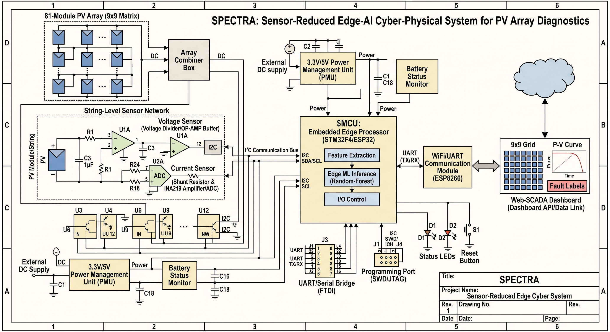

# Project SPECTRA: Multiplexed Solar Subarray Diagnostic & Fault Isolation Substation

A Hardware-in-the-Loop (HIL) solar PV diagnostic system that monitors individual panels in real time, eliminates $I^2C$ address collisions via hardware multiplexing, and isolates localized shading/line faults in under 350 ms using an opto-isolated Solid-State Relay (SSR).

---

## System Architecture



### Hardware Stack
* **Microcontroller:** ESP8266 (NodeMCU) @ 80 MHz
* **I2C Multiplexer:** TCA9548A / PCA9548A (8-Channel Bidirectional Switch)
* **Sensors:** 3x INA219 High-Side DC Current & Voltage Sensors (0.1Ω Shunt)
* **Actuation:** Opto-Isolated Solid-State Relay (SSR) for zero-arcing DC decoupling
* **Telemetry:** Chrome Web Serial API (115200 baud JSON streaming)

---

## Calibrated Fault Thresholds

| Operating State | Panel Voltage | Dashboard Status | Automated Action |
| :--- | :--- | :--- | :--- |
| **Nominal MPP** | $\ge 2.40\text{ V}$ | Green (Nominal) | SSR Armed (Closed) |
| **Partial Shading** | $1.30\text{ V} - 2.40\text{ V}$ | Amber (Degraded) | Flagged for monitoring |
| **Line Fault / Open** | $< 1.30\text{ V}$ | Red (Critical Fault) | **SSR Trips Immediately** |

---

## Documentation
* **[Download Full Technical Dossier (PDF)](technical_dossier.pdf)** — Complete schematic pinout, thermal hotspot math, and empirical test benchmarks.

---

## How to Run the Dashboard Locally
1. Flash `firmware.ino` to the NodeMCU via Arduino IDE.
2. Connect the NodeMCU to your PC via USB.
3. Start a local server in the project directory:
   ```bash
   python -m http.server 8000
